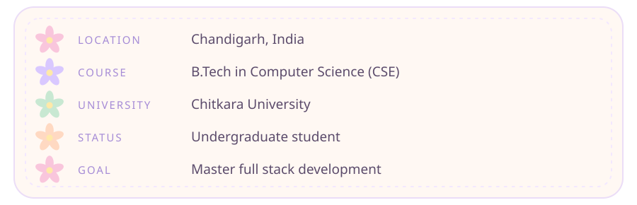
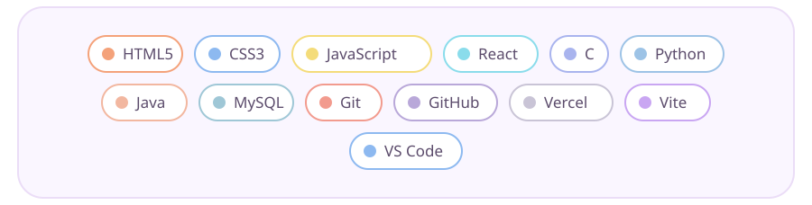

<!-- Khushi Sharma · GitHub profile README
     Put this file + the /assets folder in a repo named exactly like your GitHub username -->

 

### ✿ building things on the web, one soft pixel at a time ✿

 

 

 

- 🌸 Mastering **full stack development**, from pretty interfaces to solid backends
- 🌷 Building projects that are calm, clean and genuinely useful
- 🍃 Getting stronger at DSA and problem solving in **C, Python & Java**
- ☁️ Learning in public, shipping small, improving daily

 

 

<!-- Add more links later, e.g.:
[LinkedIn](https://linkedin.com/in/your-id) · [Portfolio](https://your-site.vercel.app) -->

 

